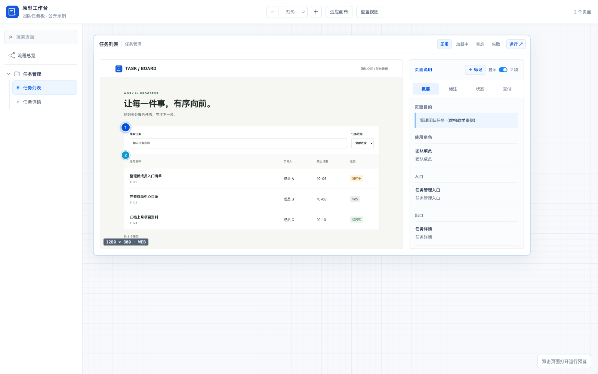

<p align="center"></p>

# PRD → Prototype

把需求文档变成**可追溯、可确认、可交互的 HTML 原型**，并交付能供开发查看的页面说明。

这是可安装到 AI 编程助手中的 Skill：AI 负责理解需求和编写页面，随包脚本负责确认关卡、结构检查、预览和标注保存。脚本本身不是一键生成模型服务，不需要配置外部 API Key；使用 AI 助手本身可能需要相应账号。



## 从需求到交付

```text
Markdown PRD
  → 需求模型与原文引用
  → 页面地图 → 确认页面范围
  → 逐页定义 → 确认功能与交互
  → 页面规格与 HTML
  → 原型查看器 / 模块标注 / 关联文档
  → 自动校验与开发交付
```

- **保留需求依据**：原文行号、短引文和 SHA-256；明确区分事实、推断和待确认项。
- **先确认再实现**：页面范围和逐页定义分别确认；上游变更会使下游确认失效。
- **多页面查看器**：目录树、流程总览、Web／移动端画布、五档缩放和运行预览。
- **开发说明**：概要、模块标注、状态、验收标准和 Markdown 文档预览。
- **可编辑标注**：新增、修改、删除和重新定位备注；本机服务保存到项目文件。
- **独立运行**：Node.js 内置模块、离线查看器和通用图标，无 npm 运行依赖。

## 快速体验

需要 Node.js 22+。克隆仓库并运行：

```bash
git clone https://github.com/Jerry0114/prd-to-prototype.git
cd prd-to-prototype
npm run check
npm run demo
```

打开 [http://127.0.0.1:8766](http://127.0.0.1:8766)。如果端口占用：

```bash
node scripts/serve_prototype_project.js --project examples/task-board/prototype --port 8877
```

内置[团队任务板](examples/task-board/README.md)包含任务列表和详情页。可以搜索、筛选、进入详情、标记完成并返回；也可以切换页面状态、编辑标注和打开关联 PRD。任务、成员和确认记录均为虚构测试数据。

## 安装 Skill

将本仓库整个文件夹放入你的 AI 助手支持的 skills 目录，并保持文件夹名为 `prd-to-prototype`。至少保留 `SKILL.md`、`agents/`、`assets/`、`references/`、`schemas/`、`scripts/`；不要只复制入口文件。

例如 Codex 的用户技能目录为 `~/.codex/skills/prd-to-prototype/`。**若已有同名版本，先备份或使用独立环境，避免覆盖原版本。**安装后重新打开助手会话，使其发现技能。其他支持文件式 Skill 的助手按各自的安装方式使用，未在本仓库声明逐一适配。

示例请求：

> 使用 $prd-to-prototype，读取我的 PRD.md，先给出页面地图和逐页定义供我确认；确认后制作桌面 Web 原型，使用项目现有设计系统，并交付页面标注与验证报告。

本 Skill 不附带企业专用 UI Kit。默认采用通用 CSS 和系统字体，也可以接入你有权使用的设计系统，见[设计系统接入](references/design-system.md)。

## 常用命令

以下命令均从 Skill 根目录执行；`my-project` 替换为已存在的业务项目路径。

```bash
# 创建独立产物目录，不生成业务页面、不覆盖已有目录
node scripts/init-prototype-project.mjs --project my-project

# AI 生成模型并取得用户确认之后，检查逐页定义关卡
node scripts/check_page_brief_gate.js --project my-project/prototype

# 复制标准查看器，再由 AI 完成页面及 prototype.json
node scripts/sync_viewer.js --project my-project/prototype

# 校验已生成产物
node scripts/validate_artifacts.js --project my-project/prototype

# 本机查看、编辑并持久化人工标注
node scripts/serve_prototype_project.js --project my-project/prototype
```

`npm test` 运行回归测试；`npm run validate:demo` 检查完整示例；`npm run audit:public` 检查公共包中的常见敏感信息和文件边界。

## 目录

```text
SKILL.md                 AI 工作流入口
agents/                  助手展示信息
assets/prototype-viewer/  查看器与通用图标
references/              需求解读、模型、标注和验证规则
schemas/                 中间产物 JSON Schema
scripts/                 初始化、同步、预览、校验与标注迁移
tests/                   回归与独立包验证
examples/task-board/     从零编写的完整虚构案例
docs/                    发布说明及来源文件哈希
```

## 使用边界

原型是沟通与开发参考，不是生产应用。自动校验验证结构与追溯关系，不替代业务确认或浏览器验收。Schema 校验器实现的是本包 Schema 所用的子集，不是通用 JSON Schema 引擎。

本机标注服务没有身份认证，只面向本机使用；写入接口限制为本机同源 JSON 请求。不要将其直接暴露到公网。纯静态托管时，标注只能保存在浏览器中，不能写回项目文件；跨浏览器不共享。

查看器会运行原型项目中的 HTML／JS，只预览你信任的项目。公开分享业务原型前，应另行检查其 PRD、页面数据和人工标注。生成报告、会话标注、压缩包、环境文件和本地日志默认不入库。

## 开发与许可

修改查看器主资产后运行同步命令更新示例，再运行 `npm run check`。GitHub Actions 在 Node.js 22 和 24 上运行同一检查。提交 PR 前请阅读 [CONTRIBUTING.md](CONTRIBUTING.md)。

本项目采用 [MIT](LICENSE) 许可；随包 Markdown 解析器的版权与许可见 [THIRD_PARTY_NOTICES.md](THIRD_PARTY_NOTICES.md)。首次发布步骤与脱敏范围见 [发布说明](docs/RELEASING.md)。
